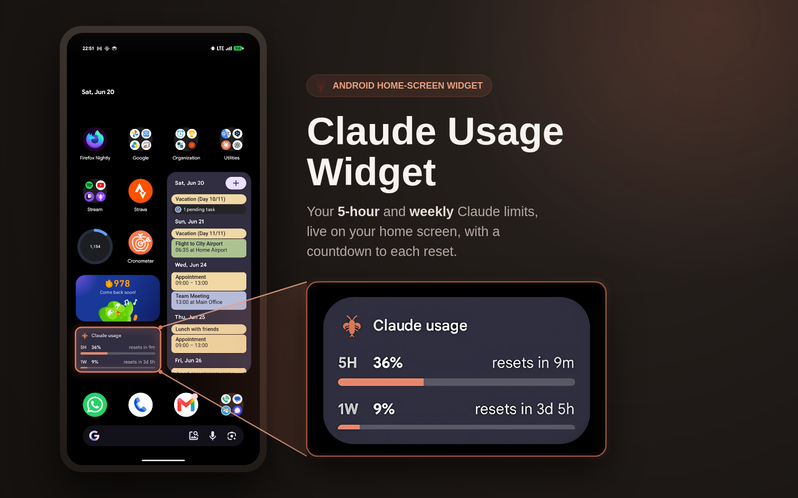

<div align="center">

# LLMit

**Track your Claude, ChatGPT, and Cursor usage limits from your Android home screen.**


<br />



</div>

---

## Widgets

- **Gauge** — single-service radial meter
- **Bars** — side-by-side usage bars for all services
- **Dashboard** — detailed breakdown with model-level stats

## Services

- **Claude** (Anthropic) — 5-hour and weekly limits, including Fable usage
- **ChatGPT** (OpenAI) — GPT-4o and o-series limits
- **Cursor** — fast and slow request counts

## Privacy

No server, no accounts, no ads, no analytics. Session cookies are stored in Android's encrypted storage. The app connects only to the AI services you sign into.

---

## Requirements

- A paid subscription to at least one supported service.
- Android 8.0 (API 26) or newer.

## Setup

1. Open LLMit and sign into your AI services.
2. Long-press your home screen → **Widgets** → **LLMit**, drag a widget on.
3. Tap the widget any time to refresh. Background refresh runs every ~15 minutes.

---

<details>
<summary><b>Build from source</b></summary>

<br />

**Requirements:** JDK 17, Android SDK with platform 36, the bundled Gradle wrapper.

Create `local.properties` in the project root:

```properties
sdk.dir=/path/to/your/Android/Sdk
```

Build the debug APK:

```bash
./gradlew :app:assembleDebug
```

Output: `app/build/outputs/apk/debug/app-debug.apk`

</details>
